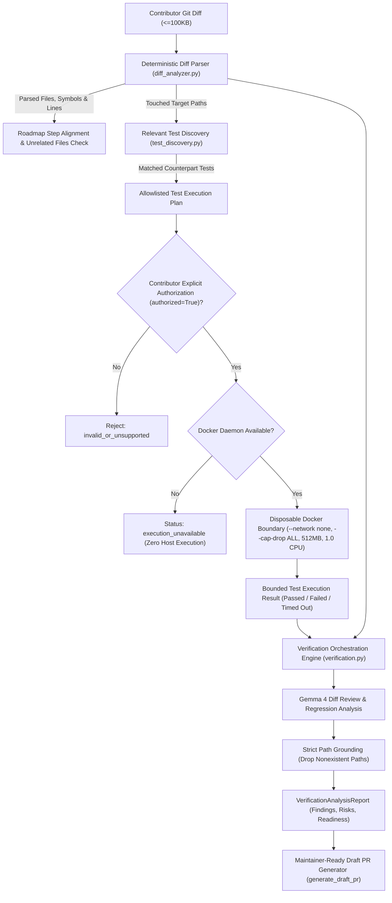

# PatchLoom Architecture & System Design

This document details the architecture, data flows, scalability boundaries, and extension patterns of **PatchLoom**.

---

## 1. System Architecture Diagram

```mermaid
flowchart TD
    User["Contributor (Web Browser)"] -->|Canonical URL & Profile| Frontend["React + Vite + TypeScript Frontend"]
    
    subgraph FastAPI Backend ["PatchLoom FastAPI Backend (Port 8000)"]
        API["Route Layer (api.py)"]
        Parser["Strict URL Parser & Guardrails (github_client.py)"]
        Signals["Deterministic Signals Engine (signals.py)"]
        PromptBuilder["Prompt Builder with XML Delimiters (prompts.py)"]
        Grounding["Path Grounding & Validation Engine (analysis.py / planner.py)"]
        Fixtures["Offline Fixture Loader (fixtures_loader.py)"]
        
        subgraph Providers ["Model Provider Layer"]
            ProviderBase["ModelProvider (base.py)"]
            Gemini["GeminiProvider: models/gemma-4-31b-it"]
        end
    end

    subgraph External ["External Services"]
        GitHub["GitHub REST API (https://api.github.com)"]
        GoogleGenAI["Google Gemini API (Gemma 4)"]
    end

    subgraph OfflineFixtures ["Local Fixture Storage"]
        FixtureFiles["Committed Snapshots (fixtures/*.json)"]
    end

    Frontend -->|POST /api/analyze| API
    Frontend -->|POST /api/plan| API
    
    API --> Parser
    Parser -->|Fetch Metadata, Tree, Issues, Docs| GitHub
    Parser -.->|Demo Mode Active| Fixtures
    Fixtures --> FixtureFiles

    GitHub --> Signals
    Signals -->|Pre-filtered Candidates (Max 12)| PromptBuilder
    PromptBuilder --> ProviderBase
    ProviderBase --> Gemini
    Gemini -->|1 Batched Fit Assessment| GoogleGenAI
    Gemini -->|1 Bounded Plan Call| GoogleGenAI
    
    GoogleGenAI --> Grounding
    Grounding -->|Drop Hallucinated Paths| API
    API -->|Ranked Issues + Evidence Badges| Frontend
    API -->|First-PR Checklist & Draft PR| Frontend
```

---

## 2. Core Architectural Principles

1. **Epistemic Discipline (Facts vs. Inference):**
   - Direct repository data (timestamps, assignees, commit logs, file paths) is verified and immutable.
   - Model assessments (fit score, estimated hours, checklist steps) are strictly labeled as inferences.
   - Incomplete checks are explicitly labeled `unknown` or `none_detected`. An unverified check is never converted into a verified negative.
2. **Strictly Non-Agentic & Read-Only:**
   - PatchLoom acts solely as an advisor. It has zero tools, zero code execution, and zero write privileges.
   - It never clones repositories, executes shell scripts, creates branches, or opens pull requests.
3. **Defense-in-Depth Against Prompt Injection:**
   - Repository descriptions, issue titles, issue comments, and documentation are untrusted user input.
   - All untrusted content is structurally wrapped within `<untrusted_issue_data>` XML delimiters.
   - System prompts instruct Gemma 4 to disregard instructions embedded within untrusted content.
4. **Hermetic Offline Capability:**
   - The application can be evaluated with zero external network connectivity using committed fixtures (`DEMO_MODE=1` or `demo=true`).

---

## 3. Scalability & Large-Repository Handling

Handling large open-source repositories (e.g. `kubernetes/kubernetes` or `torvalds/linux`) requires aggressive bounding at every layer:

### A. Bounded Model Calls
- **Single Batched Fit Call:** PatchLoom never makes $N$ individual model calls for $N$ issues. Up to 12 candidate issues are evaluated in **exactly 1 batched prompt**.
- **Single Plan Call:** When a user selects an issue, exactly **1 plan call** is executed.
- **Strict Budget Hard Cap:** Prompts are restricted to a **60,000-character hard cap**. If context exceeds this budget, file trees and issue descriptions are conservatively truncated.

### B. Bounded Tree & Issue Ingestion
- **File Tree Bounding:** GitHub's git tree API is fetched with recursive mode, but the local client caps the retained tree at **400 relevant paths**, excluding binary assets, vendor files, and lockfiles. Truncation flags are explicitly returned in the API payload.
- **Issue Bounding:** Issue pagination is strictly bounded to the top 60 open issues across at most 2 pages. PRs are excluded upstream via GitHub issue payload inspection.

### C. Stateless Design
- The backend maintains zero database state and no persistent user sessions.
- In-memory short-lived caching (5 minutes) avoids redundant GitHub requests for repeated analyses during exploration.

---

## 4. Extending PatchLoom

### A. How to Add a New Viability Signal
All deterministic viability heuristics are centralized in [`backend/app/signals.py`](file:///c:/Users/User/OneDrive/Desktop/Projects/PatchLoom/backend/app/signals.py):

1. **Define the Signal Function:**
   Implement a pure function calculating the penalty or score based on GitHub data:
   ```python
   def evaluate_has_reproduction_steps(body: str) -> SignalEvidence:
       has_repro = any(k in body.lower() for k in ("steps to reproduce", "reproduction", "repro:"))
       return SignalEvidence(
           status="verified",
           source="issue_body_heuristic",
           value="Reproduction steps documented" if has_repro else "No explicit reproduction steps",
       )
   ```
2. **Register in `compute_viability_signals`:**
   Add the signal to the candidate's signals dictionary and adjust the viability penalty if applicable.
3. **Clamp and Test:**
   Add a unit test in [`backend/tests/test_signals.py`](file:///c:/Users/User/OneDrive/Desktop/Projects/PatchLoom/backend/tests/test_signals.py) verifying that the score remains clamped in $[0, 100]$ and maps to the appropriate band (`high`, `medium`, `low`).

### B. How to Add a New Model Provider
Model providers implement the abstract interface in [`backend/app/providers/base.py`](file:///c:/Users/User/OneDrive/Desktop/Projects/PatchLoom/backend/app/providers/base.py):

1. **Implement `ModelProvider`:**
   ```python
   from app.providers.base import ModelProvider

   class LocalOllamaProvider(ModelProvider):
       async def generate_json(self, prompt: str, schema: type[BaseModel], system_instruction: str = "") -> BaseModel:
           # Call local endpoint, handle timeouts, and parse response into schema
           ...
   ```
2. **Handle Errors Safely:**
   Map provider exceptions to PatchLoom's standard errors (`QuotaExceededError`, `AuthenticationError`, `ModelTimeoutError`, `InvalidModelOutputError`).
3. **Register Provider:**
   Add the provider class to `_PROVIDER_REGISTRY` in [`backend/app/providers/__init__.py`](file:///c:/Users/User/OneDrive/Desktop/Projects/PatchLoom/backend/app/providers/__init__.py). Callers in `analysis.py` and `planner.py` automatically route to it via `get_provider(provider_name)` without requiring any changes to business logic.

---

## 5. PatchLoom 2.0: UNDERSTAND Pillar — Repository Intelligence Engine

PatchLoom 2.0 introduces the **Repository Intelligence Engine** ([`repo_intelligence.py`](file:///c:/Users/User/OneDrive/Desktop/Projects/PatchLoom/backend/app/repo_intelligence.py)), a 100% deterministic analysis subsystem powering the **UNDERSTAND** product pillar.

### Subsystem Architecture

The engine runs concurrently during repository analysis (`POST /api/analyze`) and is also exposed via standalone endpoint (`POST /api/intelligence`). It requires zero AI provider calls, zero API keys, and zero code execution:

1. **Repository Overview & Technology Discovery:**
   - Classifies primary and secondary programming languages by reconciling GitHub byte distributions with repository file extensions.
   - Detects framework, runtime, database, linter, and container technologies by matching file trees against declarative technology signatures.
   - Categorizes project type (`api_service`, `web_application`, `library_or_sdk`, `cli_tool`, `monorepo`, `documentation_or_static`, `other`) and structure type (`single_package`, `multi_module`, `monorepo`, `standard_flat`).
   - Identifies package managers (`npm`, `pip`, `poetry`, `cargo`, `go`, etc.) and dependency manifests.

2. **Entry Point Identification:**
   - Scans tree for root and subpackage application roots (`main.py`, `app.py`, `server.ts`, `index.ts`), frontend clients (`src/main.tsx`, `src/App.tsx`), library interfaces (`__init__.py`, `lib.rs`), CLI dispatchers (`cli.py`), and manifests (`package.json`, `pyproject.toml`).
   - Distinguishes verified `detected` entry points from heuristic `candidate` entry points.
   - Explains the exact reason each entry point was identified.

3. **Test Infrastructure & CI Intelligence:**
   - Detects test directories (`tests/`, `__tests__/`, `spec/`), test files (`test_*.py`, `*.test.ts`, `*_test.go`), and testing frameworks (`pytest`, `Jest`, `Vitest`, `Mocha`, `cargo test`, `go test`).
   - Reconciles CI workflow files (`.github/workflows/`) with provenance tracking.
   - Strictly models three states: `detected` (proven), `not_detected` (complete tree inspected and none found), or `unknown` (tree truncated or inspection incomplete).
   - Extracts likely test commands from docs and configurations, with explicit disclaimers: tests were never executed and no claims of passing tests are made.

4. **Documentation Profile Extraction:**
   - Bounded inspection of `README.md`, `CONTRIBUTING.md`, architecture guides, and setup documentation.
   - Extracts project purpose, setup shell commands, and test guidelines using structural markdown header and fence parsing.
   - Defensively defangs delimiter smuggling and untrusted markdown.

5. **Logical Module Partitioning:**
   - Partitions the repository tree into logical components based on top-level and subpackage boundaries.
   - Assigns component types (`core_logic`, `api_routes`, `ui_components`, `tests`, `configuration`, `documentation`, `utility`, `cli`, `service`) and confidence levels (`high`, `medium`, `low`).
   - Aggregates file counts and key entry files per module.

6. **Deterministic Issue-to-Module Mapping:**
   - Maps each candidate issue to repository components and file targets through lexical token overlap and path heuristics.
   - Assigns normalized relevance scores ($0.0 \le score \le 1.0$), specific reasons, and explicit limitations (e.g. dynamic imports and AST invocation graphs were not executed).
   - Strict Grounding Invariant: Candidate files are strictly retained from the ingested file tree.

---

## 6. Intelligent Issue Learning Engine (LEARN Pillar — M2)

The Issue Learning Engine bridges repository intelligence and issue discovery to prepare contributors to work on unfamiliar issues independently, prioritizing learning over automated code generation.

1. **Personalized Multi-Facet Issue Explanation:**
   - Adapts technical depth and tone to the contributor's experience level (`beginner`, `intermediate`, `advanced`).
   - Generates executive summary, problem description, impact rationale, expected outcome, constraints, and explicit ambiguities/unanswered questions.
   - Clarifies missing reproduction details or vague requirements so contributors can formulate targeted questions for maintainers.

2. **Requirements Extraction & Epistemic Classification:**
   - Breaks down issue text and comments into concrete, testable requirements.
   - Classifies each requirement as `explicit` (directly stated by author/maintainer) or `inferred` (logical deduction based on context), paired with verbatim evidence excerpts and confidence levels.

3. **Grounded Codebase Context & Investigation Targets:**
   - Integrates M1 logical modules and file tree heuristics.
   - Generates investigation targets with specific exploration guidance (what functions, classes, or docs to inspect).
   - Strict Grounding Invariant: Hallucinated file paths are dropped; all suggested investigation targets must exist in the verified repository file tree.

4. **Technical Concept Sequencing & Difficulty Ranking:**
   - Identifies prerequisite domain and library concepts necessary to understand the issue.
   - Sequences concepts in recommended learning order ($1 \le order \le 10$) with difficulty rankings and foundational prerequisites.

5. **Measurable Learning Objectives:**
   - Provides concrete educational milestones (what to locate, understand, and verify) before modifying code.
   - Defines clear completion criteria for each objective.

6. **Interactive Understanding Readiness Checklist:**
   - Spans 6 critical self-check dimensions: `problem_understanding`, `expected_behavior`, `architecture_components`, `technical_concepts`, `testing_approach`, and `remaining_uncertainties`.
   - Empowers contributors to self-assess comprehension with actionable guidance hints before starting implementation.

7. **Zero-AI Deterministic Fallback Invariant:**
   - When AI model inference is unavailable, in demo mode, or encounters quota/network failures, the engine generates an evidence-backed deterministic brief preserving all extracted issue requirements, grounded module mappings, and readiness items, setting `ai_status="unavailable_or_invalid"`.

---

## 7. Guided Implementation Engine (LEARN & BUILD Pillar — M3)

The **Guided Implementation Engine** ([`guided_implementation.py`](file:///c:/Users/User/OneDrive/Desktop/Projects/PatchLoom/backend/app/guided_implementation.py)) powers the **LEARN & BUILD** product pillar. It provides a structured, multi-step implementation workspace that guides contributors through an issue with progressive hints and optional educational code suggestions without writing the code for them.

### Subsystem Architecture

1. **Practical Implementation Roadmap:**
   - Decomposes the contribution into an ordered sequence of focused steps ($3 \le steps \le 7$).
   - Each step specifies title, objective, why it matters, grounded files, what to inspect, expected outcome, dependencies, and concrete completion criteria.
   - Grounding Invariant: All files associated with steps are strictly validated against the ingested repository tree. Hallucinated paths are dropped.

2. **Progressive Hint System (3-Tier Hint Hierarchy):**
   - For each step, precomputes up to 3 progressive hints that contributors reveal on explicit request:
     * **Level 1 (Gentle Direction):** High-level orientation, architectural pointers, and where to start looking.
     * **Level 2 (Specific Investigation):** Targeted functions, parameters, configuration flags, or error conditions to inspect.
     * **Level 3 (Technical Guidance & Edge Cases):** Concrete technical caveats, edge-case warnings, and idiomatic patterns.
   - Distinguishes `evidence_based` guidance (derived from verified repository code/docs) from `conceptual_guidance`.
   - Client-side persistence preserves revealed hint state per issue during the session.

3. **Grounded Code Exploration Guidance:**
   - Highlights critical repository files with target symbols (functions, classes, doc headings).
   - Specifies runtime behavior or error flows to observe and suggested search terms.
   - Zero symbol or path hallucination: paths must exist in the ingested file tree.

4. **Alternative Implementation Approaches:**
   - Evaluates multiple viable approaches (e.g. surgical minimal fix vs comprehensive defensive restructuring).
   - Compares design patterns, pros, cons/trade-offs, edge cases, regression risks, and unanswered questions for maintainers.
   - Recommends an optimal starting approach suited to the contributor's experience level.

5. **Optional Educational Code Suggestions:**
   - Strictly optional code illustrations requested explicitly by contributor interaction.
   - Always labeled with `verification_status="unverified_educational_draft"`.
   - Accompanied by explicit assumptions, expected effect, and potential risks.
   - Strict Safety Invariant: Code suggestions are never executed, never applied automatically to repository files, and never committed.

6. **Self-Reflection Step Checkpoints & Contributor Progress:**
   - Each roadmap step includes a self-reflection question and verification guidance.
   - Contributor directly controls their progress status (`not_started`, `in_progress`, `understood`, `completed`). The AI never auto-completes steps.

7. **Zero-AI Deterministic Fallback & Fixture Support:**
   - When Gemma 4 inference fails, times out, or exceeds quota, the engine synthesizes an evidence-backed deterministic roadmap and progressive hints from the repository intelligence, setting `ai_status="unavailable_or_invalid"`.
   - In offline/demo mode (`demo=true` or `DEMO_MODE=1`), serves validated snapshots or dynamic synthesis with zero external network or model calls.

---

## 8. Verification & Review Architecture (Pillar 4 - VERIFY & CONTRIBUTE)

Milestone 4 extends PatchLoom to help contributors validate their implementations, understand test results, review diffs for regressions, and prepare pull requests for maintainers.



### Key Verification Subsystems

1. **Deterministic Unified Diff Parser (`diff_analyzer.py`):**
   - Bounds input diff payload to 100KB with clean truncation warnings.
   - Normalizes `a/` and `b/` prefixes and handles `/dev/null` for newly added or deleted files.
   - Extracts file-level metrics (lines added/removed, change types) and detected function/class symbols via AST/regex patterns.
   - Cross-references touched files against planned M3 implementation steps to detect potentially unrelated changes.

2. **Repository-Grounded Test Discovery (`test_discovery.py`):**
   - Matches counterpart naming conventions (`test_<module>.py`, `<module>_test.py`, `<module>.test.ts`).
   - Inspects repository test directories and roadmap step test files.
   - Identifies test runners (`pytest`, `vitest`, `jest`, `cargo`, `go test`) and formats structured, allowlisted commands.

3. **Isolated Test Execution Boundary (`test_runner.py`):**
   - Enforces 15 non-negotiable container isolation safeguards:
     - Disposable execution with `--rm`.
     - Complete network disablement with `--network none`.
     - Dropped capabilities with `--cap-drop ALL`.
     - Read-only root filesystem with temporary bounded tmpfs.
     - Non-root user execution (`--user 10001:10001`).
     - Bounded compute: `--cpus=1.0`, `--memory=512m`, `--pids-limit=64`.
     - Strict 30-second execution timeout.
     - Command allowlist verification rejecting shell operators (`;`, `&`, `|`, `` ` ``, `$()`, `>`, `<`).
     - Explicit contributor authorization (`authorized=True`) required for all container invocations.
     - Host Isolation Invariant: Tests are never run on the host system. When Docker is offline, returns `execution_unavailable` cleanly.
     - Bounded stdout/stderr capture (32KB max) and regex parsing of test pass/fail counts.

4. **AI-Assisted Grounded Diff Review (`verification.py`):**
   - Reviews diffs against issue requirements and repository intelligence for logic errors, edge cases, error handling, security, and test coverage.
   - Assesses potential regression risks across directly affected, potentially affected, and unknown modules.
   - Strict Grounding Invariant: Hallucinated paths not present in the repository tree or diff are strictly dropped.
   - Implements 1 automatic retry on schema invalidity and complete deterministic fallback on model unavailability.

5. **Maintainer-Ready Draft PR Generator (`generate_draft_pr`):**
   - Accurately classifies tests performed into `executed_and_passed`, `executed_and_failed`, `not_executed`, and `manually_verified`.
   - Synthesizes clear PR title, summary, problem addressed, implementation overview, and manual verification checklist.
   - PRs remain pure client-side draft proposals. PatchLoom never opens PRs, creates branches, or commits code.

---

## 9. Realistic 100× Scaling Discussion (Future Work)

At 100× active users or high concurrent traffic, PatchLoom's architecture would encounter specific upstream bottlenecks. Below is an honest engineering analysis of these limits and the planned future architecture:

### Upstream Bottlenecks

1. **GitHub REST Rate Limits:**
   - *Current Status:* Unauthenticated requests are limited to 60/hr per IP; personal tokens provide 5,000/hr.
   - *At 100× Scale:* Shared personal tokens or IP pools will hit rate limits under multi-user concurrency.
   - *Future Work Solution:* Transition to a **GitHub App installation** model. GitHub Apps receive 15,000 requests/hr per installation and distribute rate limits across user organizations rather than a single server token.

2. **Model Provider Quotas & Latency:**
   - *Current Status:* Gemini API tier quotas limit requests per minute (RPM) and tokens per minute (TPM).
   - *At 100× Scale:* Bursts of concurrent users clicking "Analyze" or "Plan" will encounter `429 QuotaExceededError`.
   - *Future Work Solution:* Deploy a **multi-provider load balancer with fallback routing** (e.g., routing to self-hosted Gemma 4 instances on vLLM or secondary API keys when primary quota thresholds are approached).

3. **Synchronous Request-Response Lifecycle:**
   - *Current Status:* A live analysis request takes ~2–4 seconds (GitHub fetching + Gemma batched fit reasoning).
   - *At 100× Scale:* Holding open HTTP connections during AI generation can exhaust ASGI worker pools (e.g. Uvicorn worker starvation).
   - *Future Work Solution:*
     - **Asynchronous Task Queue:** Move repository ingestion and model reasoning into background workers using Celery or RQ backed by Redis.
     - **Real-Time Updates:** Deliver progress steps (ingestion -> signals -> AI fit) to the frontend via WebSockets or Server-Sent Events (SSE).
     - **Distributed Cache:** Replace the in-memory cache with an edge-tier Redis cluster storing repository tree snapshots and precomputed candidate signals.

> **Clarification:** These architectural enhancements represent planned future work for production-scale deployment. The P0 MVP deliberately employs a stateless, single-service FastAPI architecture to ensure complete local reproducibility and zero external infrastructure dependencies.
